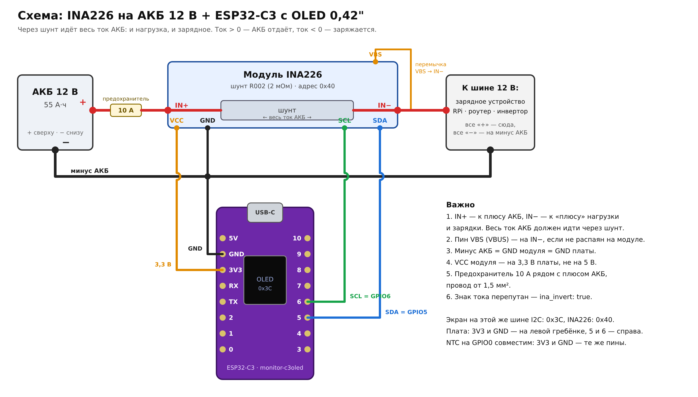

# Напряжение и ток АКБ: INA226 на шершне-мониторе

Монитор с экраном 0,42" (`monitor-c3oled`, ESP32-C3) умеет мерить 12-вольтовую батарею (ИБП, солнечная станция, погреб с
резервом) датчиком **INA226** по I2C: напряжение, **ток** (в обе стороны: разряд и заряд), мощность и сколько ампер-часов
батарея отдала с последней полной зарядки. Улей рисует это как обычные показания, графики и правила; на самом экране,
пока в Улье не выбраны строки, крупно идут вольты и амперы.

(исходник схемы — `img/ina226-wiring.svg`)

## Что купить

- Модуль **INA226** (синяя плата с клеммником IN+/IN− и штыревым разъёмом VCC, GND, SCL, SDA, ALE, VBS). На большинстве
  таких плат шунт 2 мОм (маркировка `R002`): до ±40 А, разрешение около 1 мА. Бывают `R010` (10 мОм, до ±8 А) и
  `R100` (0,1 Ом, до ±0,8 А — для заряда 4 А не годится). Номинал шунта впишите в `hw.ina_shunt_mohm`, если он не 2.
- Предохранитель 10 А (автомобильный флажковый) и провод от 1,5 мм² на силовой части: через шунт идёт весь ток АКБ.

## Что куда паять

Силовая часть (толстый провод):

1. **Плюс АКБ → предохранитель → IN+** модуля.
2. **IN− → «плюс» всех потребителей и зарядного устройства.** Через шунт должны идти и заряд, и разряд. Если нагрузка
   подключена к АКБ мимо шунта, ток покажет не всё.
3. **Минус АКБ → общий минус** потребителей и зарядного (провод идёт мимо модуля).
4. Пин **VBS** (он же VBUS) модуля — на **IN−**, если на плате он не соединён сам (проверьте: прозвоните VBS и IN− при
   выключенном питании).

Сигнальная часть (тонкие провода) на плату ESP32-C3 с экраном 0,42":

| Модуль INA226 | Плата | Пин платы |
|---|---|---|
| VCC | 3,3 В | `3V3` (левая гребёнка, при USB сверху) |
| GND | GND | `GND` (левая гребёнка), он же — минус АКБ |
| SDA | GPIO5 | `5` (правая гребёнка) |
| SCL | GPIO6 | `6` (правая гребёнка) |

GPIO5 и GPIO6 — шина I2C, на которой уже сидит экран (адрес 0x3C). INA226 стоит на ней же: адрес 0x40, конфликта нет.
Пины платы не нужно настраивать в Улье: прошивка ищет микросхему сама. Если вы уже подключили NTC на GPIO0 — он
совместим: 3V3 и GND общие (в один контакт можно запаять два провода).

**Питание платы** — отдельное (USB 5 В, например от понижающего преобразователя, который сам питается от этой АКБ).
Минус платы должен быть общим с минусом АКБ, иначе I2C и замер напряжения не заработают: это обеспечивает провод GND
модуля.

## Как читать показания

| Метрика | Единица | Что это |
|---|---|---|
| `battery_voltage` | В | напряжение на АКБ (среднее за интервал телеметрии) |
| `battery_current` | А | **плюс — АКБ отдаёт**, **минус — заряжается** (среднее за интервал) |
| `battery_power` | Вт | мощность, тот же знак |
| `battery_ah` | А·ч | сколько отдано с последней полной зарядки (см. ниже) |

Телеметрия уходит раз в `tele_interval_s` (60 с по умолчанию): прошивка читает датчик раз в секунду и присылает среднее.
Знак перепутан (минус и плюс на клеммах поменяли местами)? — `hw.ina_invert: true`.

### Счётчик А·ч

Прошивка интегрирует ток: разряд добавляет ампер-часы, заряд убавляет их с КПД 0,9, ниже нуля счётчик не идёт.
Он обнуляется, когда АКБ **полна**: напряжение не ниже `ina_full_v` (14,0 В) и ток при этом меньше `ina_full_a`
(0,5 А) десять минут подряд. Просто «14,4 В на зарядке» не значит «полная»: пока АКБ принимает амперы, счётчик идёт.
Значение хранится во флеше (раз в 5 минут), переживает перезагрузку при просадке питания.

Для оценки ёмкости: после отключения сети смотрите `battery_ah` в момент, когда напряжение под нагрузкой дошло до 11,5 В.
Ёмкость ≈ эта цифра ÷ 0,8 (колено начинается примерно на 80% разряда). Для сравнения АКБ между собой подходит та же цифра
при одинаковой нагрузке.

## Настройки в config (`hw`)

Все ключи необязательны, контракт — `contracts/schemas/config.schema.json`:

| Ключ | По умолчанию | Что это |
|---|---|---|
| `ina_addr` | 64 (0x40) | I2C-адрес (0x40…0x4F: перемычки A0, A1 на модуле) |
| `ina_shunt_mohm` | 2 | сопротивление шунта, мОм (R002 = 2, R010 = 10) |
| `ina_invert` | false | поменять знак тока |
| `ina_full_v` | 14.0 | порог «полная» по напряжению, В; 0 = не сбрасывать |
| `ina_full_a` | 0.5 | порог «полная» по току, А |

Пример: `contracts/examples/config/monitor-c3oled-ina226.json`.

Хранение в Улье для этих полей пока без отдельной формы на странице шершня: значения по умолчанию подходят модулю с шунтом
`R002`. Для другого шунта значение придётся внести в config устройства.

## Проверка

1. Подключите, откройте монитор: через пару секунд на экране крупно вольты и амперы (для 12,6 В и 1,5 А: `12.60V`, `1.50A`).
2. Включите лампочку 21 Вт: ток вырастет примерно на 1,7 А. Сверьте с мультиметром или клещами: расхождение больше 5%
   значит неверный `ina_shunt_mohm`.
3. Выдерните сетевое зарядное: ток поменяет знак на плюс (АКБ отдаёт). Не меняет — `ina_invert` или перепутаны IN+/IN−.

## Если что-то не так

| Признак | Причина |
|---|---|
| В журнале нет `[ina226] found` | модуль не отвечает: проверьте SDA/SCL, 3,3 В, адрес; экран при этом работает или нет |
| Напряжение ~0 В или ток «прыгает» | VBS не соединён с IN−; GND модуля не общий |
| Ток в разы больше или меньше | другой шунт на модуле: впишите `ina_shunt_mohm` |
| Ток около нуля при работающей нагрузке | нагрузка подключена мимо шунта |
