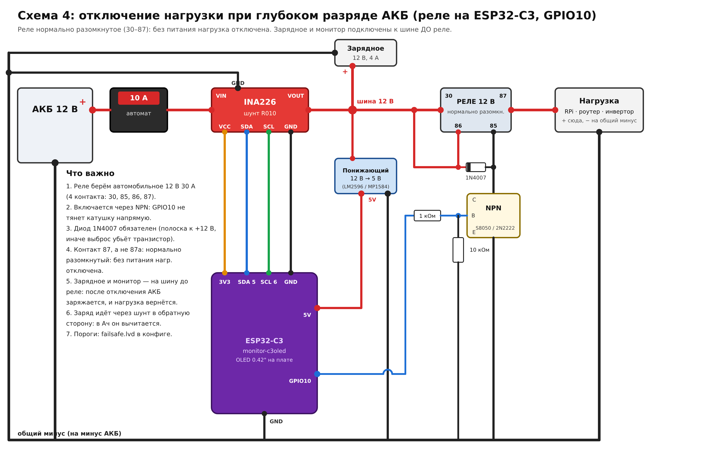

# Отключение нагрузки при глубоком разряде АКБ

Монитор с INA226 (см. `docs/ina226-battery.md`) может сам отключать нагрузку, когда напряжение АКБ упало слишком низко.
Это делает только прошивка монитора: ни Улей, ни Wi-Fi, ни MQTT для защиты не нужны.



## Как это работает

| Условие | Действие |
|---|---|
| После включения питания | нагрузка **выключена**; включается, когда напряжение ≥ `restore_v` держится 5 с |
| Напряжение < `cutoff_v` дольше `delay_s` | нагрузка отключается |
| Нет показаний напряжения 120 с | нагрузка отключается (неизмеряемая АКБ — небезопасная) |
| После отключения напряжение ≥ `restore_v` дольше `restore_delay_s` | нагрузка включается |

Пороги по умолчанию для 12 В свинцовой АКБ: `cutoff_v` 10.5 В, `restore_v` 12.4 В, `delay_s` 30, `restore_delay_s` 120.
`restore_v` всегда не меньше `cutoff_v + 0.3 В`.

Почему `restore_v` так высоко: АКБ, с которой сняли нагрузку, «отскакивает» на вольт-два за минуты. Если включаться по отскоку,
реле будет щёлкать туда-сюда и добивать АКБ. Вернуться нагрузка может только когда вернулось зарядное (напряжение заряда
выше 12.4 В) или АКБ действительно отдохнула.

## Схема

* Реле автомобильное 12 В на 30 А, **нормально разомкнутое** (контакты 30 и 87, не 87a): при пропадании питания монитора
  нагрузка остаётся выключенной.
* GPIO10 → 1 кОм → база NPN (S8050 / 2N2222), 10 кОм от базы на минус, коллектор на вывод 85 реле, эмиттер на минус.
  Вывод 86 — на +12 В шины. Диод 1N4007 параллельно катушке (полоска к +12 В): без него выброс катушки убьёт транзистор.
* Зарядное устройство и питание монитора (понижающий 12 → 5 В) подключаются к шине **до** реле, после INA226. Тогда после
  отключения нагрузки АКБ заряжается, монитор жив и видит рост напряжения.
* Ток заряда идёт через шунт в обратную сторону и вычитается из счётчика А·ч.
* Если реле стоит с другой логикой, поменяйте `hw.relay_active_low`.

## Настройка (config)

```json
"hw": { "relay_pin": 10 },
"failsafe": { "lvd": { "cutoff_v": 10.5, "restore_v": 12.4, "delay_s": 30, "restore_delay_s": 120 } }
```

`hw.relay_pin` включает защиту (в Улье: вкладка пинов, строка «relay»). Источник напряжения — INA226, без него —
делитель `hw.vbat_pin`. Если нет ни того, ни другого, нагрузка остаётся выключенной, в журнал уходит предупреждение.
Пример: `contracts/examples/config/monitor-c3oled-ina226-lvd.json`.

Состояние нагрузки публикуется как retained `state` с полем `load`: `on` или `off`. В журнал пишутся события
«load cut», «load restored».

## Что проверить руками

1. Без нагрузки вместо АКБ поставить регулируемый блок питания, опустить ниже `cutoff_v`, подождать `delay_s`: реле отпускает.
2. Поднять до 12.5 В: через `restore_delay_s` реле включается.
3. Выдернуть питание монитора: нагрузка отключена.
4. Помните: автомат 10 А на выходе АКБ защищает проводку, но не заменяет предохранитель у клеммы.

Логика отключения — `firmware/lib/hornet-core/src/LowVoltageCutoff.h`, тесты — `firmware/test/test_lvd`.
